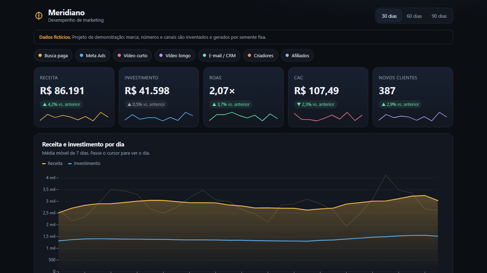
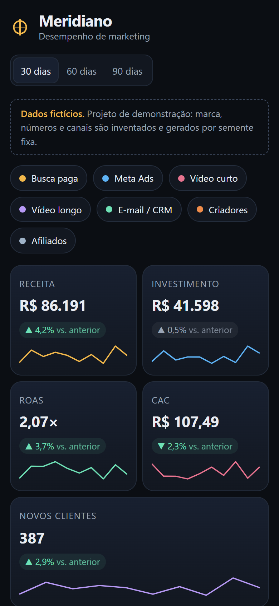

# Meridiano — marketing performance dashboard

**Live demo:** https://alissonlittig.github.io/meridiano-marketing-dashboard/

A dark, single-page dashboard for a digital marketing team: **CAC, ROAS, spend mix, funnel and channel comparison** across seven acquisition channels (paid search, Meta Ads, short video, long video, e-mail/CRM, creators, affiliates).

> **All data is fictional.** "Meridiano" is a made-up brand. The dataset (180 days × 7 channels) is generated by a seeded script in `src/data.js`, so it is deterministic and describes no real business.




## What you can do
- Switch the window (30 / 60 / 90 days); every KPI shows the delta against the previous equal window.
- Toggle channels on and off; every chart, the table and the funnel recompute.
- Hover the revenue/spend line for a daily tooltip (7-day moving average).
- Compare channels on a CAC × ROAS bubble chart (bubble size = spend) with a break-even reference.
- Sort the channel table, read the weekday × channel ROAS heatmap, follow the impression → customer funnel.

## Stack
Vanilla JS + [Observable Plot](https://observablehq.com/plot/) + Vite. Metrics live in `src/metrics.js` (pure functions, unit tested with Vitest). Responsive down to 390 px with no horizontal page scroll; keyboard-focusable controls; charts re-render on resize.

| Metric | Definition |
|---|---|
| ROAS | revenue / ad spend |
| CAC | spend / new customers |
| CPC | spend / clicks |
| Conversion | customers / clicks |

## Run it
```bash
npm ci
npm test        # vitest: metrics + dataset sanity
npm run dev
npm run build   # static output in dist/
```

CI (`.github/workflows/pages.yml`) runs tests and the build on every push and deploys `dist/` to GitHub Pages from `main`.
